  
  
  

---

## 👨‍💻 About me

I'm **Raul Adriano**, a **Systems Analysis and Development (ADS) student at UNICID**, based in São Paulo, Brazil. **Expected graduation: 2028.**

My main interests are **Software Engineering and Backend Development**, with an emphasis on **Python (FastAPI)** and **Java (Spring Boot)**. I also build responsive web interfaces and use AI tools to support learning, planning and development.

I enjoy solving problems, structuring code, working with databases and turning ideas into projects that can be tested and improved.

- **Current focus:** Python Backend · Java Backend · Software Engineering
- **Backend foundations:** REST APIs · Authentication · SQL · Relational databases
- **Complementary skills:** HTML · CSS · JavaScript · Git · Docker
- **Opportunity:** Technology internship, especially backend or software development

## 🧰 Technical skills

  

| Area | Skills / tools |
| :--- | :--- |
| **Python Backend** | Python · FastAPI · SQLAlchemy · REST APIs |
| **Java Backend** | Java · Spring Boot · REST APIs |
| **Software Engineering** | Layered architecture · Git · Testing fundamentals · Documentation |
| **Databases** | PostgreSQL · SQLite · MySQL · SQL Server |
| **Frontend** | HTML5 · CSS3 · JavaScript · Responsive Web |
| **Data & BI** | SQL · Pandas · Power BI · Excel |

## 🤖 AI tools I use

I use **ChatGPT, Gemini and Claude** to explore technical concepts, brainstorm approaches, review code and improve documentation. I validate suggestions and aim to understand the solutions I implement.

## 🚀 Selected projects

| Project | What it demonstrates | Tech |
| :--- | :--- | :--- |
| 🔐 **[Auth Customer API](https://github.com/rauladrixdev/auth-customer-api)** | Registration, authentication, JWT and password hashing | Python · FastAPI · SQLAlchemy |
| 👥 **[Employee Management API](https://github.com/rauladrixdev/sistema-funcionarios-backend)** | Employee-management REST API with Java backend | Java · Spring Boot · MySQL |
| 🧱 **[TaskFlow API — in progress](https://github.com/rauladrixdev/taskflow-api)** | API design, project setup and incremental development roadmap | Python · FastAPI · Docker |
| 📊 **[Customer Segmentation DW](https://github.com/rauladrixdev/dw-segmentacao-clientes-abc)** | ABC classification and dimensional SQL analysis | SQL Server |

### 🌐 Real client work

**KV Estofados — responsive business website (2026).** Developed and delivered a website showcasing services, result images and a customer contact flow. A practical example of working with real requirements.

<strong>📂 Other work and projects</strong>

- [Sales Dashboard](https://github.com/rauladrixdev/dashboard-vendas-powerbi) — Power BI and business indicators
- [E-commerce Logistics Analysis](https://github.com/rauladrixdev/portfolio_olist_ecommerce) — Python and Pandas
- [Personal Portfolio](https://rauladrixdev.github.io/) — HTML, CSS and JavaScript

<strong>🇧🇷 Sobre mim em português</strong>

Sou estudante de **Análise e Desenvolvimento de Sistemas na UNICID**, com **conclusão prevista para 2028**. Tenho interesse principalmente em **Engenharia de Software e desenvolvimento Backend com Python/FastAPI e Java/Spring Boot**. Também desenvolvo interfaces frontend e utilizo ChatGPT, Gemini e Claude como apoio aos estudos e à programação. Busco oportunidade de estágio em tecnologia para continuar aprendendo e contribuir com projetos reais.

---

**Building software. Learning consistently. Improving through practice.**

  
  
  

