 

  

  

---

## ✦ Building technology with purpose

I'm **Raul Adriano**, a **Systems Analysis and Development student at UNICID**, based in São Paulo. **Expected graduation: 2028.**

My main focus is **backend development** — Python, REST APIs and databases. I also enjoy building **frontend interfaces**, developing responsive websites and exploring how **AI tools** can help me learn and create.

| ⚙️ Backend | 🎨 Frontend | 🤖 AI workflow |
| :---: | :---: | :---: |
| Python · FastAPI · SQL | HTML · CSS · JavaScript | ChatGPT · Gemini · Claude |
| PostgreSQL · APIs | Responsive UI | Ideas · Study · Code review |

## 🛠️ Toolkit

<strong>Also familiar with:</strong> SQL Server · MySQL · SQLite · Pandas · Power BI · Excel

## 🤖 AI tools I use

I use AI assistants for studying, brainstorming, reviewing and documenting code. I verify suggestions and prioritize understanding what I build.

## 🚀 Selected projects

| Project | Focus | Stack |
| :--- | :--- | :--- |
| 🔐 **[Auth Customer API](https://github.com/rauladrixdev/auth-customer-api)** | User authentication, JWT and password hashing | Python · FastAPI · SQLAlchemy |
| 👥 **[Employee Management API](https://github.com/rauladrixdev/sistema-funcionarios-backend)** | Employee management REST API | Java · Spring Boot · MySQL |
| 🧱 **[TaskFlow API — In progress](https://github.com/rauladrixdev/taskflow-api)** | Task management API with documented development roadmap | Python · FastAPI · Docker |
| 📊 **[Customer Segmentation DW](https://github.com/rauladrixdev/dw-segmentacao-clientes-abc)** | SQL analytics, ABC analysis and dimensional modeling | SQL Server |

**Real client work:** KV Estofados — responsive website for an upholstery-care business, with services, results gallery and contact flow.

**Also explored:** [Sales Dashboard](https://github.com/rauladrixdev/dashboard-vendas-powerbi) · [E-commerce Logistics](https://github.com/rauladrixdev/portfolio_olist_ecommerce) · [Personal Portfolio](https://rauladrixdev.github.io/)

🇧🇷 Sobre mim em português

Sou estudante de **Análise e Desenvolvimento de Sistemas na UNICID**, com **conclusão prevista para 2028**. Meu principal foco é **backend**, especialmente Python, FastAPI, APIs REST e bancos de dados. Também desenvolvo interfaces frontend e utilizo ChatGPT, Gemini e Claude como apoio aos estudos e projetos. Busco oportunidades de estágio em tecnologia.

---

**Build · Learn · Improve**

